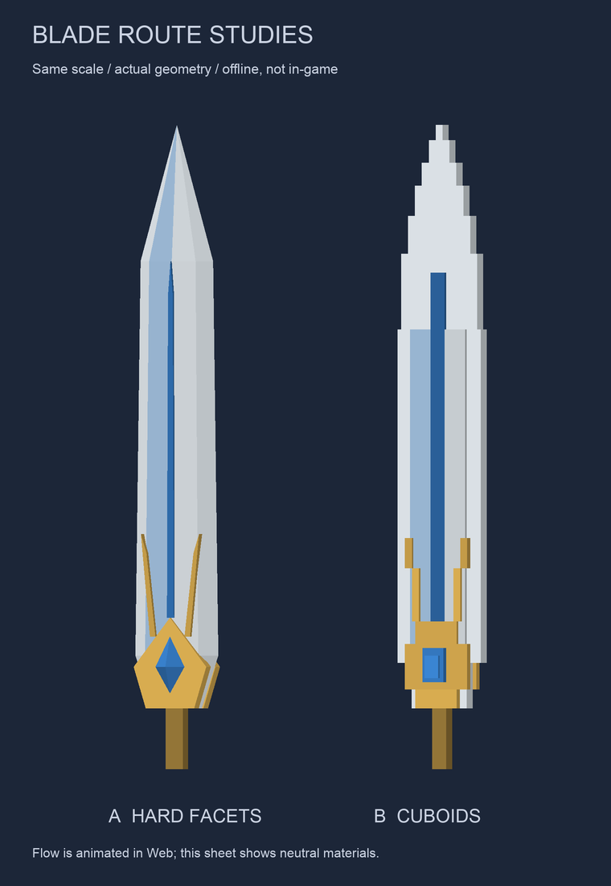

# 剑刃模型路线对比 · 2026-11-16

这次只做一个剑刃部件的两种展示台试验。共同参照 `art/parts3v/blade_views/front.png` 的白蓝石质、金饰、蓝宝石，统一总高 1.70m（含短插榫）、尖端 +Y、根挂点 `(0,0,0)`。保留原武器存档、属性、碰撞、背挂和手持逻辑；不扩展护手、握柄、剑首与弓。

## 实际产物

- `scripts/combat/ForgeShowroomBlades.lua`：两套真实几何、三色映射、分帧上传、生命周期。A 是平面硬法线网格；B 是 1cm 格点上的 33 个无旋转长方体。检查了 `/Applications`、`~/Applications` 与 PATH，未发现可用 Blockbench，采用授权的等价程序化方式，没有声称用 Blockbench GUI 制作。
- `assets/model/forge-blades/BladeStudy.shader` + `.xml`：共享不透明 PBR SurfaceShader，无贴图、无描边壳、无屏幕采样。`.meta` 由 Maker 官方生成器生成。
- `scripts/combat/ForgeShowroom.lua`：路线选择、F6/F7 调试入口、构建失败回退，沿用同一个展示台灯光与 `0x40000000` mask。
- `art/parts3v/route_studies/route-A.png`、`route-B.png`、`comparison.png`：由实际 Lua 顶点离线投影生成并人工看图检查，**不是引擎截图，不代表 Web 验收通过**。`render_studies.py` 可复现图片与 `metrics.json`。没有 AI 概念图替代真实几何。



## 数量与体积

| 项目 | A：硬边风格化 | B：精细格点长方体 |
|---|---:|---:|
| 三角形 | 178 | 396 |
| 非索引顶点 | 534 | 1,188 |
| 长方体数量 | 插榫 1，其余为斜面/棱柱 | 33 |
| 包围尺寸 X/Y/Z | 0.24 / 1.70 / 0.15m | 0.24 / 1.70 / 0.14m |
| AABB 包围体积 | 0.06120m³ | 0.05712m³ |
| 顶点流估计，36B/顶点 | 19,224B（18.77KiB） | 42,768B（41.77KiB） |
| 新贴图/贴图内存 | 0 张 / 0B | 0 张 / 0B |
| 几何批次 | 1 个子网格 + 1 个材质 | 1 个子网格 + 1 个材质 |

顶点流含 position 12B、normal 12B、RGBA8 4B、UV 8B；不含驱动对齐、引擎 CPU 副本和 Lua table 开销。包围体积不是实体材料体积，也不是碰撞体积。两路线共用约 8.6KB Lua 源码、1.24KB shader、89B XML；实际构建压缩体积尚未测量。B 保留少量相交/内部盒面，396 三角形是实际提交数，未按遮挡后的可见面虚减。

## 造型与材质

**A**：八边截面、三段刃体和收尖；大块白/蓝平面替代写实大理石裂纹；刃根金色折线、正反面四面宝石。平面法线保持硬边。采用克制的 PBR 高光，不依赖 Toon 专属路径，避免引入额外平台组合。轮廓更利落，近景比体素更精致，但仍可能比遗迹环境平滑。

**B**：1 个格点单位 = 0.01m，原武器 `VOXEL_SIZE=0.03` 不变。剑身用长条块，尖端用五级收束台阶；金饰、剑脊、宝石也是直角块。最接近现有世界。侧面保留厚度，宝石突出有层次；近距离能看见台阶和方形宝石。几何比 A 多，但总量仍很小。

## 三通道换色

两路线都以顶点 RGB 存 **主色/副色/点缀权重**，alpha 存面明度，完全不需要重绘纹理。由 `single.colors` 的原六色色板索引映射：

- 主色 `primary_color`：石质。色板值按 `0.70 + 0.30 × RGB` 提亮，保留象牙白大块面。蓝石区混入 35% 点缀色；改主色会得到柔和浅色，不会把白石完全染黑。
- 副色 `secondary_color`：金属边饰、插榫。使用原色板，金属度约 0.72、粗糙度约 0.39。
- 点缀 `accent_color`：宝石、剑脊、部分蓝石平面。色板乘 `(0.42,0.66,0.94)`，得到更饱和的蓝宝石基调；流光同步跟随该颜色。

A/B 默认都采用当前剑的 `3/1/2`（遗迹灰/时砂金/冰蓝）。这是一套有白石与冷宝石倾向的派生配色，不是色板 RGB 的逐值复刻。每个展示实例 clone 材质，避免污染缓存材质或另一把武器。当前 `SetWeapon` 换色沿用整体分帧重建；shader 本身支持只改 3 个 uniform，后续可优化成直接刷新颜色。

## B 的扫光与脉动

UV.x 标记普通表面=0、剑脊=0.35、宝石=1；UV.y 是 `localY / 1.7`。使用引擎 `TIME`，亮带约每 3.57 秒从根部向尖端扫一次，扫出剑尖后才从下方重启。宝石另有约 2.62 秒柔和脉动。白石和金属不被整体染成霓虹灯。

`SetFlowStrength(value)` 接收 0–2，默认 0.7，0 完全关闭；NaN/无穷沿用上一值。F7 在 0 和 0.7 之间切换。A 始终 flow_strength=0，便于辨认硬边自身高光。

流光和不透明剑刃在**同一个材质片元里**完成：增加 0 个几何批次/0 个特效 draw、0 张贴图、0 个灯、0 个逐帧 CPU 上传/重建。剑刃自身是 1 个材质批次；展示间多灯/阴影/后处理可能让原生总 draw 数大于 1，不能把“一个材质批次”宣传成整场景只有一次 GPU 提交。Web 使用普通 spatial/PBR + EMISSION/TIME/UV/颜色运算，不使用 compute、屏幕采样或额外透明 pass。**Web shader 编译、真实帧时和 Bloom 强度仍待远端预览确认**。低画质 Bloom 关闭时仍能看到表面扫光，但不会有外扩光晕。

上传每帧最多 96 顶点：A 6 个上传帧，B 13 个上传帧，另有初始化帧；Commit 是不可分割的原生调用，不能承诺其在所有设备都低于 2ms。切换时旧模型保留到新模型发布，取消/退出释放私有材质和节点。资源或上传失败回退原体素剑并保留 `Diagnostic()`。

## 挂点与碰撞

展示试验只导出 `root={0,0,0}`、`top={0,1.7,0}`（米）；展示台居中与整体旋转在父节点完成，原始数据不变。没有新建 `RigidBody`、`CollisionShape` 或 `VoxelPhysicsWorld`。

进入正式武器系统时，建议保留 `WeaponBuilder.Compile()` 的整剑 grip/guard/blade sockets、现有 `WeaponRig:GetHit()` 的扫掠/胶囊判定，把新剑刃作为纯可视子节点：使用 `blueprint.geometry.offsets.blade × Parts.VOXEL_SIZE` 对齐原根挂点，并按选中剑刃原长度缩放或明确升级全剑尺寸。**不要直接把展示用 1.7m 剑刃挂上去后沿用旧短刃判定**；本轮没有执行这个正式替换。常规碰撞无需逐三角形；如未来要静态掉落物，可用盒/凸包代理。

## 切换与给 Claude 的接线接口

启动默认 `original`，退出重进会保留本次会话所选试验路线；不保存到磁盘。

```lua
local Showroom = require('combat.ForgeShowroom')
Showroom.SetModelRoute('A') -- 'original' / 'A' / 'B' / 'imported'
Showroom.CycleModelRoute() -- original → A → B → original
Showroom.GetModelRoute()
Showroom.SetFlowStrength(0.7) -- [0,2]
Showroom.GetFlowStrength()
```

桌面 Web：进入锻造库、选剑后按 F6 循环三方案，F7 开关流光；弓不响应试验热键。`imported` 保留上一版 Tripo 真模型作额外参照，不在默认三项循环里。旧 `SetModelOverride(nil)` 继续恢复原体素。

**手机接线待 Claude**：本轮按边界没有改 `ForgePanel.lua`。可在其现有调试/预览控件区加“原版 / A 硬边 / B 体素”按钮或下拉框，调用上面同一接口；再加 0–2 强度滑条，仅 B 可用。用户切换失败时用 `Diagnostic()` 提示回退，`GetModelRoute()` 返回请求路线而非实际回退结果。

## 推荐与验收

推荐先在 Web 比较 B：它与体素遗迹更统一，同时给剑脊一个可控的动感亮点；A 作为用户更偏好利刃与宝石切面的备选。不要在用户选定前批量改其余武器。

1. 同样的转角下比较整体风格：A 是否仍显精致、B 的 1cm 台阶在常用距离是否自然。
2. 转到正/侧/背检查刃根装饰、宝石厚度、尖端、金饰与刃面有无穿帮或闪烁。
3. B 查看至少一个完整扫光周期，分别试 0、0.7、2；切低画质后确认表面扫光仍可见。
4. 三路颜色分别更改；快速 A/B/原版、剑/弓切换；关闭重开；竖屏/横屏检查适配和资源清理。
5. 留意 `blade_route` 错误；若 shader 原生编译失败，留日志并使用原体素回退，不把离线图当成实机通过。

最终验证：`/tmp/pxvenv/bin/python -I /tmp/run_all54.py` 为 **52 suites / 0 failed**，完整日志 `/tmp/forge-blades-tests-final.log`。`python3 /tmp/all-lsp.py` 为 **ERRORS 0**，日志 `/tmp/forge-blades-all-lsp-final.log`；补充本轮四个 Lua 文件的检查也为 **ERRORS 0**，日志 `/tmp/forge-blades-own-lsp.log`。`git diff --check` 通过。人工审查记录 `/tmp/forge-blades-review.md`。未提交、未构建、未启动本地 Runtime。
