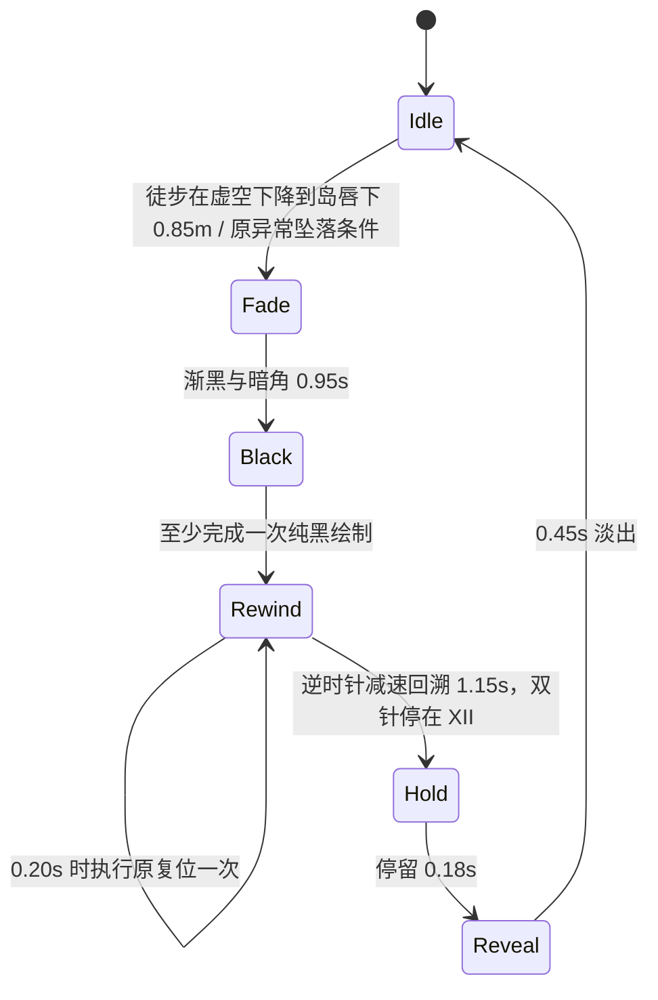

# 虚空回溯过场

2026-11-14。仅增加徒步坠落的表现与时序；原安全点选择、出生兜底、速度清零、相机归位及 `onVoidReturn` 清理合并为 `NomiController:ReturnFromVoid()`，过场和关闭开关的即时复位共用。没有重建场景，也没有重置谜题、TimeObject 或 DayNight。世界继续正常更新。

## 时序

正常 60Hz 离线时序约 **2.767s**，包含状态切换帧。开始即清充能、触摸所有权、鼠标拖动与吐息，复用 `voidInputBlocked` 锁定移动、技能、视角、骑乘、远景与手动快进。传送发生在回溯期间的黑幕下，剩余黑幕给相机和角色落地留出时间。结束解除控制器的 `voidReturning`，`voidInputBlocked` 仍等待 PC 持续按键/鼠标按钮松开；触摸旧手指被取消，不会自动续跑或施法。

`Black` 等待 UI 真正执行全屏不透明绘制，不能只凭计时器传送；渲染暂停时宁可保持遮挡状态。`Update` 单步至多推进 0.1 秒，避免后台恢复的大 dt 跳过黑屏及相机稳定阶段。因此低于 10fps 或页面挂起时总墙钟时长会延长。

## 集中参数

全部在 `scripts/ruins/VoidRewind.lua` 顶部 `CONFIG`。

| 参数 | 默认值 | 含义 |
| --- | --- | --- |
| enabled | true | 总开关；false 保留旧判定时的即时传送 |
| fallDepth | 0.85m | 离开永久岛域、低于 RING_Y 此距离且实际向下运动才提前起幕 |
| fade | 0.95s | 由透明至纯黑，边缘暗角先加深 |
| rewind | 1.15s | 逆时针三次方减速动画 |
| teleportAt | 0.20s | 回溯开始后执行原复位的时间，必须小于 rewind |
| hold | 0.18s | 双针抵达 XII 后停留 |
| reveal | 0.45s | 表盘先淡、黑幕后淡 |
| minuteTurns / hourTurns | 3 / 0.25 | 分针回溯三圈；时针从 III 回到 XII，角速度比 12:1 |
| ringSizeRatio | 0.92 | 外环画布边长 / 安全区内短边 |
| dialToRingRatio | 0.64 | 表盘及两根指针的共同画布边长 / 外环画布边长 |
| ringSpeed | 6°/s | 高画质外环缓慢顺时针，与指针方向相反 |
| dustCount | 10 | 缓慢上飘金尘数量 |
| retrySeconds | 0.5s | 图片缺失或尺寸未就绪的重试间隔 |

不在地面上但向上跳跃、尚未低于岛唇、站在可靠桥面时不提前开始。原低碎块脱困、`fallY=-5` 与 `hardFallY=-24` 仍为强制触发兜底。正常骑龙、上龙和下龙过渡沿用 Scene 的徒步安全检查旁路。

## 挂接点

- **VoidRewind.lua**：`Start(blackout, finished)`、`Update(dt)`、`Draw(vg)`、`IsActive()`、`Attach(root)`、`Stop()`；活动状态重复 Start 不替换回调，不叠加过场。`GetState/BlackAlpha/HandAngle` 也供离线检查使用。
- **NomiController.lua**：`UpdateSafety` 原阈值之前增加可选 `onVoidFall(pos, forced)`；接受过场时置 `voidReturning` 并清水平意图，继续自由下坠。过场期间不覆盖安全点、不重复触发；`ReturnFromVoid` 是原复位代码的原样提取。
- **RuinsScene.lua**：在 `onVoidReturn` 邻接处连接回调，原回调内容保留（包括并行加入的战斗退出）；`Update` 推进过场并扩展原输入松开门闩；`AttachTouchControls` 连接 UI 层；`Stop` 在 HUD 销毁前释放图片。
- **UI 层**：复用 `UI.Panel:Extend`，由 UI 的 `NanoVGRender` 渲染，没有额外订阅或 `nvgBeginFrame`。使用 UI 支持的 `position='fixed'` 绘制层，盖住普通 HUD、触摸按钮及并行加入的性能/设置面板。过场开始关闭已开的设置菜单；过场期间不切换调试根节点。没有改 RuinsHUD、PixelDraw 或触摸素材。

坐标采用系统逻辑 dp：物理宽高 / DPR，补偿 UI.GetScale 的密度因子；安全区从 UI.GetSafeAreaInsets 换算到 dp。表盘居安全区中心、随短边连续缩放，黑幕覆盖整个屏幕包含安全区。开启抗锯齿，图片使用默认线性过滤，不套用像素 HUD 的整数缩放或最近邻过滤。

非过场期间图层隐藏、不绘制、不查询图片、不更新状态机；场景仅有轻量 IsActive 判断和原安全检查中的分支。过场中十个程序化尘点，不创建粒子对象；罗马数字用矢量笔画绘制，无字体创建。

## 降级与日志

可选依赖均通过 `pcall(require, ...)` 读取；GameSettings 或 DebugLog 不存在时不报错，默认采用高画质且无日志。`Attach` 注册 `GameSettings.RegisterQuality('voidRewind', ApplyQuality)`；设置系统 Stop 清除注册后，下一次 HUD 挂接会重新注册，不订阅独立逐帧事件。

| 实际档位 | 表盘/指针 | 外圈 | 星点/暗角 | 时长倍率 | 60Hz 离线总时长 |
| --- | --- | --- | --- | --- | --- |
| 高 | 保留 | 6°/s 缓慢旋转 | 开启 | 1 | 2.767s |
| 中 | 保留 | 静止 | 关闭 | 0.84 | 2.333s |
| 低 | 保留 | 不绘制、不加载 | 关闭 | 0.72 | 2.017s |

时长倍率统一作用于渐黑、回溯、传送时点、停留、淡出。三档都保留完整黑幕绘制门闩、一次传送、输入释放门闩与图片缺失回退。档位只在每次过场开始时固定；自动画质中途变化从下一次坠落生效，避免缩短正在进行的阶段造成跳帧或突然露出世界。高档时长仍由文件顶部 CONFIG 调整；`GetQuality()` 返回当前活动档或下一次将使用的档位。

关键日志仅记录开始（含档位）、重复 Start 被忽略、纯黑首次绘制、传送执行、过场结束，标签统一 `VoidRewind`，带内部经过秒数。每个调用点都先检查 `DebugLog and DebugLog.enabled`，关闭时不调用日志函数、不格式化、不建立记录表或缓冲，不额外采集逐帧统计。没有新增无门控 print。

设置入口使用 `VoidRewind.IsActive()` 判断过场是否进行中；这个接口已保留给设置模块使用。Scene 的 F10 入口及触摸动作同时受到原 `voidInputBlocked` 阻断，已开的菜单在开始过场时关闭。此追加接入没有修改设置模块或继续改动共享 Scene 的输入逻辑。

## 素材约定与回退

由美术主会话提供 `assets/ui/rewind/` 下的五张 PNG：

| 文件 | 规格及使用 |
| --- | --- |
| rewind_dial.png | 透明正方形、中心同心、XII 正上、I–XI 顺时针；静止 |
| rewind_ring.png | 透明正方形、同心装饰环；缓慢顺时针转动，与指针反向 |
| rewind_hand_hour.png | 透明正方形；枢轴严格在画布中心、指向正上；整幅绕中心旋转 |
| rewind_hand_minute.png | 同上，分针较长 |
| rewind_spark.png | 透明小星芒，金色尘点 |

运行时引用使用 `ui/rewind/...`，不加 assets 前缀。代码使用完整字面路径保留构建资源引用链。每个 UI NanoVG 上下文分别缓存句柄；尺寸大于零才绘图，否则使用矢量表盘、环、指针、尘点。每 0.5 秒重新检查晚就绪/缺失图片，不画白色占位方块，成功后不重复创建。场景停止时只删除仍有效 UI 上下文的图片句柄。

2026-11-14 离线检查时五图已由主会话落盘，表盘/环/两针均为 1024²、星芒 256²，RGBA 透明通道有效，PNG `.meta` 已存在。代码会自动使用这些图片。新 Lua 的 `.meta` 由主会话在整合/构建资源检查时生成，不能手写 UUID。

## 离线验证

测试与完整日志仅在 `validation/void-rewind/`，不提交。未启动本地 Runtime、窗口、headless 或 surfaceless，也未触发远端构建、提交或推送。

- `python3 validation/void-rewind/check.py`：lupa.lua54 加载全部 scripts Lua，Error=0；真实 VoidRewind/Nomi 模块加引擎 mock，动态提取当前 Scene 回调、松键门闩及骑乘旁路检查。
- 已检查：提前下坠判定与跳跃/支撑排除、渐黑中无传送、缺少纯黑绘制时不传送、重复开始不替换回调、逆时针单调回溯、XII 停针、仅传送一次、速度/相机/安全点/出生兜底、连续坠落、低残块、过场结束与松键恢复、总时长、关闭开关或无 UI 的即时回退、骑龙与上下龙旁路、图片零尺寸节流/晚到切换、空闲无图片工作、Stop 释放。
- `python3 validation/void-rewind/lsp_check.py`：本机 maker-lua-lsp 对三个本任务 Lua 文件诊断 Error=0，见 `lsp.log`。
- 全项目诊断另存 `lsp-all.log`；共享工作区中其他并行文件及既有测试目前有 Error，不能宣称全项目 LSP 已全绿。未修改这些文件来消除无关诊断；整合后由主会话复查。
- `git diff --check`：通过。自查涵盖状态重入、UI 绘制顺序、资产缓存/销毁及原安全检查旁路。
- 追加验证 `quality-check.log`：三档特效及旋转开关、低档不绘制外圈/星点、分别 2.767/2.333/2.017s、表盘与双针同尺寸、表盘/外环比例 0.64、双针速度比 12:1；档位中途变化不影响活动过场；日志关闭调用数为零，开启时五个关键事件各一次；设置生命周期重挂接、可选模块缺失均通过。追加本任务三个 Lua 的静态诊断见 `lsp-quality.log`，Error=0。

## Web 必看

- [ ] PC、844×390、915×412 横屏从岛外缘和裂隙坠落：暗角与渐黑约一秒，黑幕无 HUD/触摸/性能面板穿透。
- [ ] 位图确实加载，透明区无白块或黑方片；两针枢轴同心、逆时针、减速停在 XII；外环与数字不相互遮挡。
- [ ] 慢网络首坠落矢量可用、图片到位后正常替换，无资源错误导致黑屏卡死。
- [ ] 回安全点时全黑，相机没有在淡出后才甩回，真实物理速度已清零且稳定落地。
- [ ] 按住 WASD/施法、三指触控、途中失焦/恢复、连续坠落；充能不误释放，旧触摸不会续跑，键鼠松开后正常重新输入。
- [ ] 谜题及桥回溯进度保留，昼夜自然流逝，黑幕不是快进世界；骑龙穿越虚空不触发。
- [ ] 已开设置菜单时坠落、F10/Tab/触摸菜单尝试、性能小字打开：过场始终盖住场景与普通 UI。
- [ ] disabled 分支恢复原即时复位；低残块和异常穿地兜底可脱困。
- [ ] 设置切换高/中/低后分别坠落，检查特效和时长变化；过场期间设置入口忽略；自动降档不会打断当前过场。
- [ ] 开启调试日志能看到 VoidRewind 的关键时点，关闭后无相关打印；实际设备帧耗开销仍需 Web 性能采样。

以上实际引擎物理、Web 图片上传/绘制、视觉、美术比例和设备触摸均**未验证**；mock 不替代 Web 验收。
